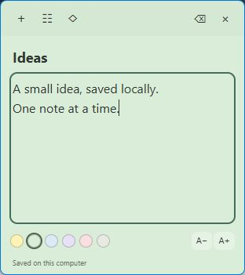

# Desk notes

Simple offline sticky notes for the Windows desktop, built with TypeScript,
Electron and plain HTML/CSS. Each note is an independent window.



## First version

- Create multiple notes from the panel or the plus button on any note.
- Edit a title and plain text, with automatic local saving.
- Choose six pastel colors and a text size from 12 to 28 pixels.
- Move/resize notes and optionally keep each note always on top.
- Hide a note and reopen it from the panel; previous visible windows reopen on launch.
- Move notes to Trash and restore them. There is no permanent deletion in this version.
- English and Portuguese interface, selected in the panel.

Text editing is deliberately plain text: normal selection, copy/paste and native
undo/redo. Rich text, lists, images, cloud sync, reminders, startup at login and
search are future possibilities, not implemented features.

## Use on Windows

Download the x64 portable preview from [Releases](https://github.com/baruth91/desktop-sticky-notes/releases).
No installer is required. This community build is unsigned.

1. Open Desk notes and click New note.
2. Write your title and text. The save indicator confirms local persistence.
3. Choose a color with the dots; use A-/A+ to adjust the body text.
4. Use the diamond to toggle always-on-top, and the list icon to open the panel.
5. The X on a note hides it. Reopen it from All notes. Trash is reversible.
6. Save and exit closes the application after requesting pending editor saves.

The tray icon also opens the panel or exits. Closing the panel with Alt+F4 hides
it; the application remains in the tray. Hidden notes are not deleted. Restoring
from Trash returns a hidden note to All notes; click Open to put it on the desktop.

## Data and recovery

Notes are stored as plain JSON at `%APPDATA%/desktop-sticky-notes/notes.json`.
Portable describes the executable, not a data folder beside it. There is no login,
telemetry or application backend. Keep notes appropriate for an unencrypted local
file; the app is not a password vault.

The previous valid save is retained as `notes.backup.json`. Updates are serialized
and written to a temporary file before rename. Corrupted files stop startup with
an explicit error and remain untouched. To recover manually, exit the app, keep a
copy of the damaged file, and restore a verified backup. One previous save is not
an independent long-term backup.

Edits are debounced for 300 ms. Hiding, moving a note to Trash and Save and exit
request an editor flush first. If an editor fails to save or acknowledge within
five seconds, the operation reports an error. Abrupt process termination or OS
shutdown can still lose edits that have not reached disk. Undo history is not
persisted. A notebook is limited to 1,000 notes including Trash, 120 title characters
and 100,000 body characters per note; these are safeguards, not scalability claims.

## Develop

Node.js 22.12 or later, npm and Windows for the portable build:

```sh
npm ci
npm run typecheck
npm test
npm start
npm run pack:win
```

The portable file is `release/desk-notes-0.1.0-windows-x64.exe`. Builds do not publish
automatically. Dependencies are pinned in package-lock.json. To test separately
from personal notes, set `DESK_NOTES_DATA_DIR` to a dedicated disposable directory
before launching; do not point it at unrelated folders.

## Learn from the code

- `src/model.ts`: note schema, input validation and off-screen window correction.
- `src/storage.ts`: serialized transactions, snapshots, backup and atomic rename.
- `src/main.ts`: independent windows, tray, narrow IPC and editor-flush acknowledgments.
- `src/preload.ts`: explicit bridge, without exposing general Node/Electron APIs.
- `src/renderer.ts`: native DOM, autosave, local editing and bilingual labels.
- `tests/notes.test.ts`: deterministic rules plus actual temporary-file persistence.

The UI uses textContent and plain text fields, not note HTML. Renderer processes
are sandboxed with context isolation and no Node integration. Remote requests,
new windows and navigation are blocked; IPC checks the sender and its role.

## Verification

See [verification](docs/verification.md) for executed checks and remaining native
acceptance work. This is a public programming/learning project, not a claim of
production readiness. Feedback and small, well-scoped improvements are welcome.

MIT license. Original icon drawn in code; the screenshot contains fictional text.
